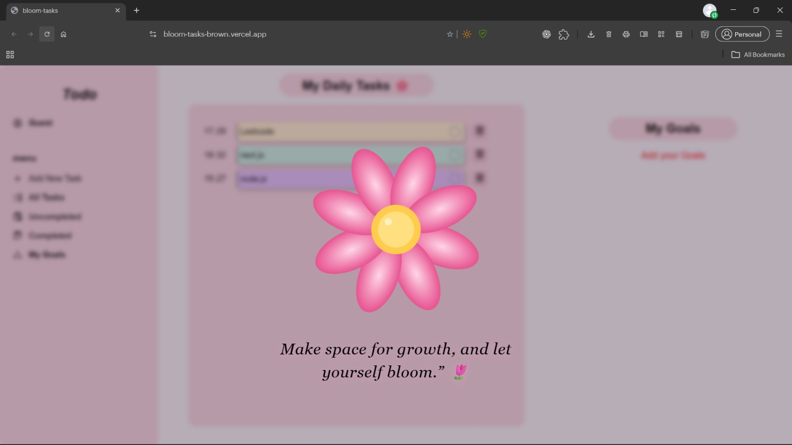
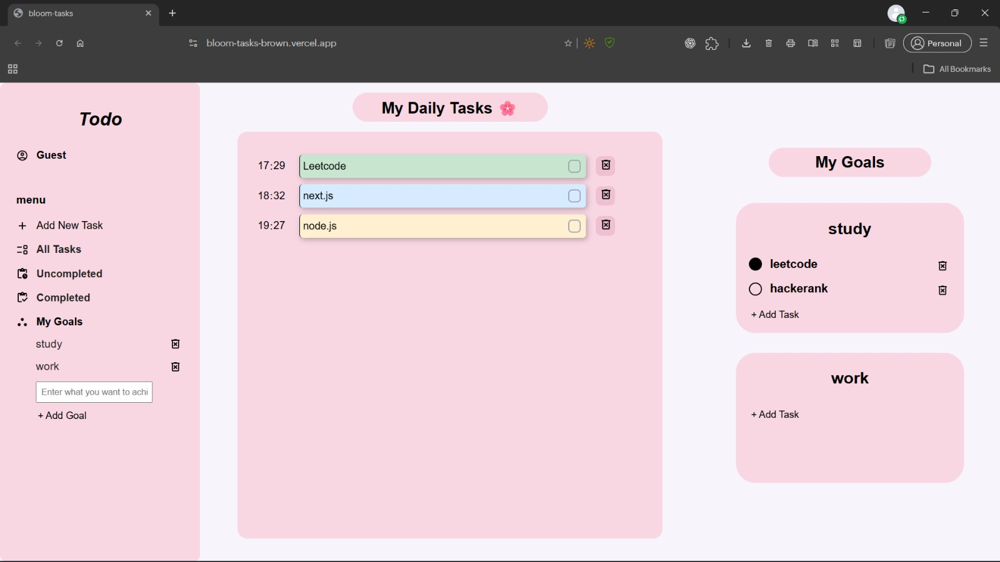

<div align="center">

# 🌸 Bloom Tasks

**A beautiful pastel-inspired todo app built with React.**

Plan your tasks, track your goals, and enjoy a calm, colorful workspace.

[](https://bloom-tasks-brown.vercel.app)
[](https://react.dev/)
[](https://vitejs.dev/)
[](LICENSE)

[**View Live Demo**](https://bloom-tasks-brown.vercel.app) · [**Report a Bug**](https://github.com/sairam-saridi/bloom-tasks/issues) · [**Request a Feature**](https://github.com/sairam-saridi/bloom-tasks/issues)

</div>

---

## 📸 Screenshots

<div align="center">

| Intro Screen | Home Page |
| :---: | :---: |
|  |  |

</div>

---

## 📖 Table of Contents

- [About the Project](#-about-the-project)
- [Features](#-features)
- [Tech Stack](#-tech-stack)
- [Getting Started](#-getting-started)
- [Available Scripts](#-available-scripts)
- [Project Structure](#-project-structure)
- [Roadmap](#-roadmap)
- [Contributing](#-contributing)
- [License](#-license)
- [Author](#-author)

---

## 🌷 About the Project

**Bloom Tasks** is a clean, soft-toned task management app designed to make planning your day feel less like a chore. It combines a pastel color palette with a simple, distraction-free interface so you can focus on what matters: getting things done and growing your goals, one task at a time.

The app is built with **React** and **Vite**, uses a component-based architecture, and is deployed on **Vercel**.

---

## ✨ Features

- 🌼 **Animated intro** – a welcoming flower animation greets you when the app loads
- ✅ **Task management** – add, update, and delete tasks from an interactive task board
- 🪟 **Task modal** – create and edit tasks through a focused pop-up form
- 🔎 **Task filtering** – quickly filter your tasks to see what's relevant
- 🎯 **Goals list** – add and remove personal goals alongside your daily tasks
- 📊 **Overview panel** – see a summary of your tasks and goals at a glance
- 🎨 **Pastel design** – a soft, cohesive color theme across the whole interface

---

## 🛠 Tech Stack

| Category | Technology |
| --- | --- |
| Framework | [React](https://react.dev/) |
| Build Tool | [Vite](https://vitejs.dev/) |
| Styling | CSS (component-scoped stylesheets) |
| Linting | [ESLint](https://eslint.org/) |
| Deployment | [Vercel](https://vercel.com/) |

---

## 🚀 Getting Started

Follow these steps to run Bloom Tasks on your local machine.

### Prerequisites

- [Node.js](https://nodejs.org/) (v18 or higher recommended)
- npm (comes bundled with Node.js)

### Installation

1. **Clone the repository**

   ```bash
   git clone https://github.com/sairam-saridi/bloom-tasks.git
   ```

2. **Navigate into the project folder**

   ```bash
   cd bloom-tasks
   ```

3. **Install dependencies**

   ```bash
   npm install
   ```

4. **Start the development server**

   ```bash
   npm run dev
   ```

5. **Open your browser** and visit the local URL shown in your terminal (usually `http://localhost:5173`).

---

## 📜 Available Scripts

| Command | Description |
| --- | --- |
| `npm run dev` | Starts the development server with hot reload |
| `npm run build` | Creates an optimized production build in `dist/` |
| `npm run preview` | Previews the production build locally |
| `npm run lint` | Runs ESLint to check code quality |

---

## 📁 Project Structure

```
bloom-tasks/
├── docs/
│   └── screenshots/          # README screenshots
├── src/
│   ├── components/
│   │   ├── GoalsList.jsx     # Goals list component
│   │   ├── Overview.jsx      # Overview / summary panel
│   │   ├── Taskboard.jsx     # Task board with task cards
│   │   └── TaskModal.jsx     # Modal for adding / editing tasks
│   ├── styles/
│   │   ├── GoalsList.css
│   │   ├── Overview.css
│   │   ├── Taskboard.css
│   │   └── TaskModal.css
│   ├── App.jsx               # Root component and app state
│   ├── colors.js             # Shared pastel color palette
│   ├── icons.jsx             # Reusable icon components
│   ├── index.css             # Global styles
│   ├── IntroFlower.jsx       # Animated intro component
│   ├── IntroFlower.css
│   └── main.jsx              # Application entry point
├── .gitignore
├── eslint.config.js
├── index.html
├── LICENSE
├── package.json
├── package-lock.json
└── vite.config.js
```

---

## 🗺 Roadmap

Ideas for future improvements:

- [ ] Persist tasks and goals between sessions
- [ ] Due dates and reminders
- [ ] Task categories and tags
- [ ] Drag-and-drop task reordering
- [ ] Dark mode
- [ ] Mobile-first responsive refinements

Have an idea? [Open an issue](https://github.com/sairam-saridi/bloom-tasks/issues) and let's talk about it.

---

## 🤝 Contributing

Contributions make the open-source community a wonderful place to learn and create. Any contribution you make is **greatly appreciated**.

1. Fork the project
2. Create your feature branch (`git checkout -b feature/AmazingFeature`)
3. Commit your changes (`git commit -m "Add some AmazingFeature"`)
4. Push to the branch (`git push origin feature/AmazingFeature`)
5. Open a Pull Request

---

## 📄 License

Distributed under the **MIT License**. See [`LICENSE`](LICENSE) for more information.

---

## 👤 Author

**Sairam Saridi**

- GitHub: [@sairam-saridi](https://github.com/sairam-saridi)
- Project Link: [github.com/sairam-saridi/bloom-tasks](https://github.com/sairam-saridi/bloom-tasks)

---

<div align="center">

If you like this project, please consider giving it a ⭐ — it really helps!

Made with 💖 and React

</div>
